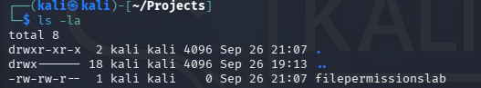
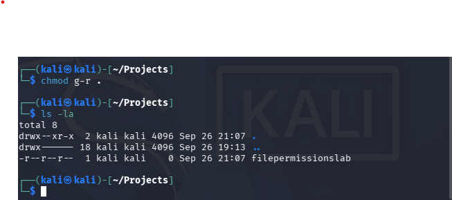
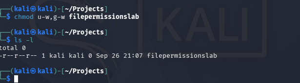
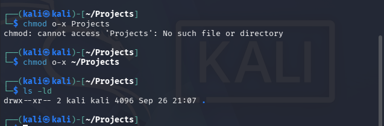

# File permissions in Linux

**Reading permission strings and restricting access with `chmod`, on the way to least privilege**

| | |
|---|---|
| Type | Access control lab |
| Platform | Kali Linux |
| Commands | `ls -la`, `chmod` |
| Status | Complete |

## Objective

Permissions are an access-control mechanism, and most real-world "the data was exposed" stories are
an over-permissive file or directory rather than a broken cipher. The task: inspect what a user can
actually do to files and directories, identify access that is broader than the role requires, and
correct it.

## Reading the permission string

`ls -la` shows files, directories, hidden entries, ownership and the permission string. The string is
ten characters: the first marks a file (`-`) or directory (`d`), then three groups of three for the
owner, the group, and everyone else.

```
-rwxr--r--   owner read, write, execute
            group read only
            other read only
```

Each position is `r` (read), `w` (write), `x` (execute) or `-` (not granted).

Before any change:



## Removing group read on a hidden entry

Hidden files and directories are the ones starting with a dot, and `ls -la` is what makes them
visible at all. Removing a permission with `chmod`, then re-checking with `ls -la`:



The check afterwards is not ceremony. `chmod` reports success when it changes the mode bits, not when
it produces the access model you intended, so the verification step belongs in the habit.

## Removing write access from a file



`u-w,g-w` strips write from both the owner and the group, leaving `-r--r--r--`. For a file that should
be a record rather than a working copy, that is the correct end state: it can be read, not quietly
altered.

## Directories, and a command that failed



Removing execute from "other" on a directory matters more than the same change on a file: without
`x` on a directory, nobody in that class can traverse into it, regardless of what the files inside
allow.

The screenshot also preserves a mistake. The first attempt was:

```bash
chmod o-x Projects
```

…run *from inside* `Projects`, which returned `chmod: cannot access 'Projects': No such file or
directory`. The path resolved to `~/Projects/Projects`. The corrected command used the absolute form:

```bash
chmod o-x ~/Projects
```

and `ls -ld` confirmed the result. The failure is included here because "the command errored, so the
permission must already be correct" is exactly the wrong conclusion — the command never ran against
the object at all.

## What this demonstrates

- Reading and explaining a Linux permission string rather than copying commands from a walkthrough.
- Using `chmod` deliberately on files, hidden entries and directories, where the same permission bit
  has different consequences.
- Verifying every change with `ls`, and diagnosing a path mistake instead of assuming the change
  succeeded.

## Why it matters

Least privilege is easy to state and easy to break: one `chmod 777` during troubleshooting, one
directory left group-writable, one hidden file carrying credentials that anyone on the box can read.
Being able to inspect and correct those states is the difference between a policy and a working
control.

---

*Full document: [`File Permissions in Linux`](https://docs.google.com/document/d/1eElW39_qWVmQPwpuVl0TG-6-T6wI8LpZYaFpP1bkFRY/edit)
in the Drive archive — it includes the remaining screenshots of the final permission state.*
