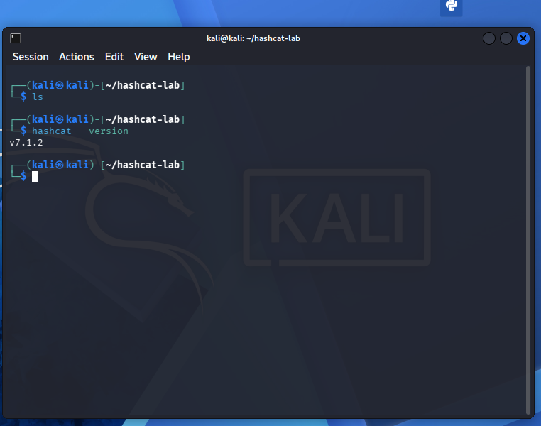
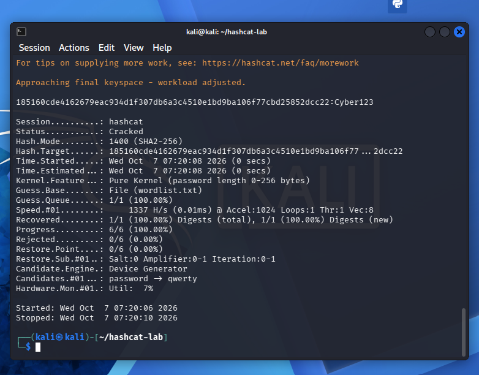
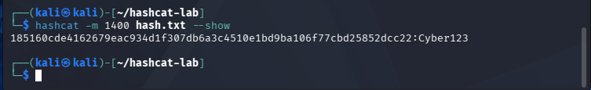

# Password hash auditing with Hashcat

**Recovering a SHA-256 test hash with a dictionary attack, and what that says about password storage**

| | |
|---|---|
| Type | Password hash auditing |
| Platform | Kali Linux in VirtualBox |
| Tool | Hashcat v7.1.2 |
| Algorithm | SHA-256 (mode 1400), dictionary attack (`-a 0`) |
| Target | A hash of a password I created for the lab |
| Status | Complete |

> Every value in this lab is self-created. The password, the hash and the six-entry wordlist were all
> generated for the exercise; no real account, credential or third-party system was involved.

## Objective

Understand how a password hash is actually attacked, because "we hash passwords" is often treated as
the end of the conversation. Hashing is not encryption and it is not a guarantee — it is a deliberate
slowdown, and this lab was about measuring how much slowdown you get.

## Setup

Hashcat was configured to run on CPU through PoCL (the portable OpenCL implementation), in a Kali VM
with an isolated `hashcat-lab` working directory.



The test password was `Cyber123`, hashed with SHA-256:

```bash
echo -n "Cyber123" | sha256sum
```

```text
185160cde4162679eac934d1f307db6a3c4510e1bd9ba106f77cbd25852dcc22
```

The wordlist contained six candidates: `password`, `123456`, `letmein`, `Welcome1`, `Cyber123`,
`qwerty`. The test password was deliberately included, because the point of the exercise is to
demonstrate *why* a predictable password fails, not to claim success against a strong one.

## The attack

```bash
hashcat -m 1400 -a 0 --potfile-disable hash.txt wordlist.txt
```

- `-m 1400` — SHA-256
- `-a 0` — straight (dictionary) attack
- `--potfile-disable` — ignore previously cracked results, so the run starts from a clean state

## Result

```
Status...........: Cracked
Recovered........: 1/1 (100.00%) Digests
Guess.Queue......: 1/1 (100.00%)
Candidate.#01....: password -> qwerty
```





One hash, one recovered password, a handful of seconds on a CPU. Note what did not happen: the hash
was not reversed. Hashcat hashed each candidate and compared the results, which is why the answer is
limited to what is in the wordlist.

## What this demonstrates

**Hashing is a control, not immunity.** A hash removes the plaintext from the database. It does not
stop someone hashing candidate passwords and looking for a match — it only decides how long that
search takes.

**Speed of the hash is the whole ballgame.** SHA-256 is fast by design, which makes it a good general
hash and a poor password hash. Here the wall clock was irrelevant because the wordlist had six
entries; with a real wordlist and a fast hash, the same reasoning scales to millions of guesses per
second on a GPU.

**Predictability beats length.** `Cyber123` is nine characters with mixed case, a digit and a pattern
— it still fell because it was in a dictionary of likely passwords. Attackers do not start with
random strings.

## Defensive recommendations

- Use long, unique, randomly generated passwords — and a password manager so uniqueness is realistic.
- Never reuse a password between accounts.
- Enable MFA, which makes a recovered password insufficient on its own.
- Store passwords with a purpose-built KDF — Argon2id, bcrypt, scrypt or PBKDF2 — not a fast
  general-purpose hash like SHA-256.
- Salt every stored password uniquely, so precomputed tables and identical passwords do not collapse
  into a single shared hash.
- Configure work factors so that legitimate verification is expensive and guessing is more expensive
  still.

## Scope and ethics

Performed only against a hash I generated, in a lab, as a defensive exercise: the deliverable is an
argument about password storage policy, not a method for attacking anyone. Hashcat should only ever
run against hashes you own or have explicit written authorisation to audit.

## Limitations

Six dictionary entries and one hash is a demonstration, not a benchmark. It says nothing about GPU
throughput, rule-based or mask attacks, or the strength of any real password — the recovered password
was in the wordlist by design.

---

*Full document: [`Password Hash Auditing Lab — Hashcat`](https://docs.google.com/document/d/1VvFKgJntW9F41-e7iLLxrogboAMESEuV59ycUW55NS4/edit)
in the Drive archive — it includes all six screenshots and the full methodology.*
